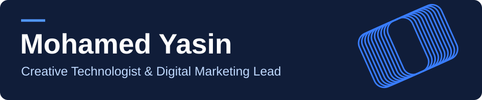

I design brand identities and build software for **web, mobile, and desktop**. I also lead digital marketing, from shaping a campaign’s creative direction to measuring how people use the finished product.

### Software development
I build full-stack web apps, cross-platform mobile apps, desktop utilities, and API integrations.  
**Languages** · JavaScript, TypeScript, Dart, PHP, SQL  
**Stack** · React, Node.js, Flutter, Laravel, Supabase, PostgreSQL, Firebase

### Brand identity & design
My design work spans visual identities, interface prototypes, campaign artwork, and 2D and 3D motion.  
**Studio tools** · Illustrator, Photoshop, Figma, After Effects, Cinema 4D

### Digital marketing
I plan campaigns, track customer journeys, and build reporting workflows that help teams decide what to improve next.  
**Analytics & automation** · Google Analytics 4, Microsoft Clarity, n8n

---

### Featured project
**[Multiplayer browser game](https://github.com/Moeyasin88/wormate-game)**  
A multiplayer game with a React frontend and Node.js backend.

[Browse public repositories →](https://github.com/Moeyasin88?tab=repositories)
